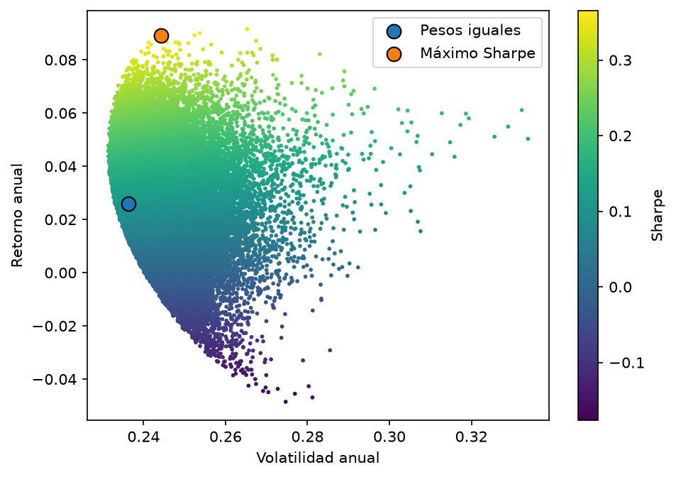
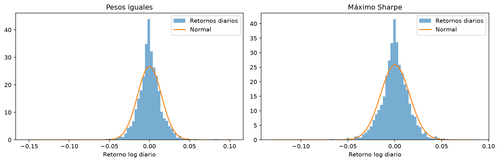
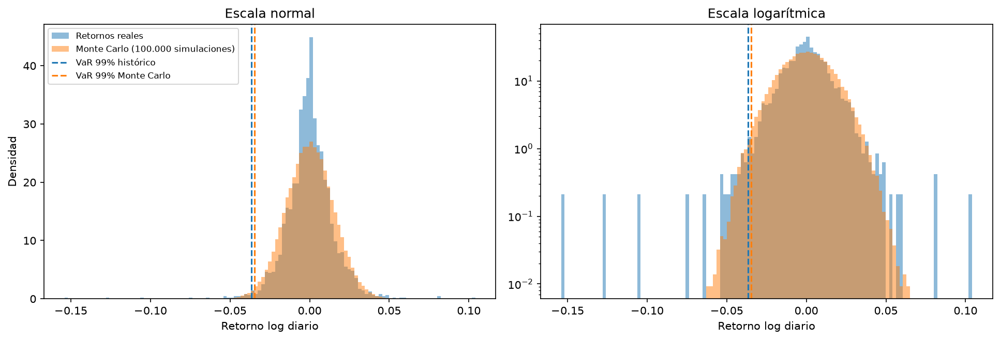

# Motor de riesgo de un portafolio de acciones chilenas

Ejercicio educativo en Python: calculo el riesgo de un portafolio de 6 acciones chilenas con VaR y CVaR a 1 día, por tres métodos distintos, y comparo qué tan bien se sostiene el supuesto de normalidad. **No es asesoría financiera.**

## Objetivo

Medir cuánto podría perder un portafolio en un mal día (VaR y CVaR al 95% y 99%) y ver cuánto cambia la respuesta según el método. La pregunta de fondo es si el supuesto de retornos normales, que es el más usado en la práctica, subestima el riesgo real de las acciones chilenas.

## Datos

- **Acciones (6):** Falabella, Copec, SQM-B, BCI, Cencosud y CMPC (`FALABELLA.SN`, `COPEC.SN`, `SQM-B.SN`, `BCI.SN`, `CENCOSUD.SN`, `CMPC.SN`). Precio de cierre ajustado por dividendos y splits, descargado de Yahoo Finance con `yfinance`.
- **Referencia:** el índice `^IPSA` no descarga en Yahoo, así que uso el ETF `CFMITNIPSA.SN`, que replica el IPSA. Es un ETF, no el índice en sí, por lo que puede haber pequeñas diferencias.
- **Período:** del 2018-01-02 al 2026-10-22 (2.190 días). Datos descargados el 23 de octubre de 2026. El CSV está en `data/precios_ajustados_2018-01-01_descarga_2026-10-23.csv`.
- Se excluye el día de la descarga, porque durante el horario de mercado es un precio parcial y no un cierre.

## Metodología

1. **Retornos:** logarítmicos diarios. Para anualizar uso 250 días (media diaria × 250, covarianza diaria × 250), siempre la misma convención.
2. **Portafolios:** uno de pesos iguales (1/6 cada acción) y uno de máximo Sharpe, elegido entre 50.000 combinaciones de pesos al azar. La tasa libre de riesgo se deja en 0, así que el Sharpe es simplemente retorno anual dividido por volatilidad anual. El retorno diario del portafolio es la suma ponderada de los retornos de cada acción, con pesos constantes.
3. **Normalidad:** asimetría, curtosis (en exceso, la normal vale 0) y test de Jarque-Bera sobre los retornos diarios de cada portafolio, con histograma contra la curva normal.
4. **VaR y CVaR a 1 día, al 95% y 99%**, por tres métodos. Las pérdidas se reportan como números positivos y no se anualizan.
   - **Histórico:** percentil de los retornos reales; el CVaR es la pérdida promedio de los días peores que el VaR.
   - **Paramétrico:** supone retornos normales con la media y desviación de la muestra (`scipy.stats.norm.ppf`).
   - **Monte Carlo:** 100.000 días simulados de las 6 acciones juntas con `np.random.multivariate_normal`, usando la media y la covarianza diaria.

## Resultados

### Portafolios (retornos log, 250 días, tasa libre de riesgo = 0)

| Portafolio | Retorno anual | Volatilidad anual | Sharpe |
|---|---|---|---|
| Pesos iguales | 2,59% | 23,64% | 0,11 |
| Máximo Sharpe | 8,93% | 24,42% | 0,37 |

Pesos del portafolio de máximo Sharpe (redondeados): BCI 58,0%, SQM-B 17,8%, Cencosud 10,3%, Copec 7,1%, Falabella 4,6% y CMPC 2,3%. Está muy concentrado en BCI, y se optimizó con los mismos datos con que se evalúa.



### Normalidad de los retornos diarios

| Portafolio | Asimetría | Curtosis en exceso | Jarque-Bera | p-valor |
|---|---|---|---|---|
| Pesos iguales | -0,63 | 10,91 | 10.992 | < 0,001 |
| Máximo Sharpe | -0,49 | 7,47 | 5.180 | < 0,001 |

Se rechaza la normalidad en los dos casos: los retornos tienen sesgo negativo y colas mucho más gordas que una normal.



### VaR y CVaR a 1 día (pérdida positiva, en %)

**Pesos iguales**

| Método | VaR 95% | CVaR 95% | VaR 99% | CVaR 99% |
|---|---|---|---|---|
| Histórico | 2,23 | 3,35 | 3,67 | 5,76 |
| Paramétrico (normal) | 2,45 | 3,07 | 3,47 | 3,97 |
| Monte Carlo | 2,44 | 3,07 | 3,46 | 3,97 |

**Máximo Sharpe**

| Método | VaR 95% | CVaR 95% | VaR 99% | CVaR 99% |
|---|---|---|---|---|
| Histórico | 2,35 | 3,45 | 3,83 | 5,73 |
| Paramétrico (normal) | 2,50 | 3,15 | 3,56 | 4,08 |
| Monte Carlo | 2,51 | 3,15 | 3,55 | 4,08 |

Porcentaje de días de la muestra en que la pérdida superó el VaR (lo esperado es 5% y 1%):

| Método | Pesos iguales 95% | Pesos iguales 99% | Máx. Sharpe 95% | Máx. Sharpe 99% |
|---|---|---|---|---|
| Histórico | 5,03 | 1,01 | 5,03 | 1,01 |
| Paramétrico / Monte Carlo | 3,88 | 1,32 | 4,25 | 1,42 |



### Qué encontré

- **El modelo normal subestima las pérdidas extremas.** El VaR 99% paramétrico queda entre 5% y 7% por debajo del histórico, y el CVaR 99% queda entre 29% y 31% por debajo (3,97% frente a 5,76% en pesos iguales). Además, el VaR 99% paramétrico se superó en 1,32% de los días (1,42% en máximo Sharpe), cuando debería ser 1%.
- **Al 95% pasa lo contrario.** El VaR paramétrico (2,45%) queda por encima del histórico (2,23%) y se supera en menos días de los esperados (3,88%). Con colas gordas la distribución real también es más puntiaguda en el centro, y la normal exagera el riesgo "de todos los días" mientras subestima el extremo.
- **Monte Carlo y paramétrico dan casi lo mismo** (diferencias de 0,01 punto porcentual), lo que es esperable porque parten del mismo supuesto normal. Monte Carlo solo agrega ruido de muestreo.

## Limitaciones

- El VaR normal subestima las colas gordas, como se ve arriba. Para el CVaR 99% la diferencia es de alrededor de 30%.
- El pasado no predice el futuro: todo se calcula con datos de 2018 a 2026.
- Los parámetros (media, volatilidad, correlaciones) se suponen constantes, aunque en crisis cambian.
- Solo acciones chilenas en pesos: no hay renta fija ni tipo de cambio.
- El portafolio de máximo Sharpe está optimizado en muestra, así que su desempeño es optimista y no es una recomendación.
- La tasa libre de riesgo es 0, lo que sube el nivel del Sharpe respecto de uno calculado con una tasa real.
- La referencia es un ETF que replica el IPSA, no el índice.
- El retorno del portafolio se calcula como suma ponderada de retornos logarítmicos, una aproximación estándar a escala diaria, y con pesos constantes.
- Los datos vienen de Yahoo Finance y pueden tener errores o ser corregidos después.
- Es un ejercicio educativo, no asesoría financiera.

## Cómo correrlo

1. Descarga el repositorio (botón verde **Code** > **Download ZIP**) y descomprímelo.
2. En la terminal, dentro de la carpeta:
   ```bash
   python3 -m venv .venv
   source .venv/bin/activate
   pip install -r requirements.txt
   ```
3. Abre `riesgo_portafolio.ipynb` (en VS Code o con `jupyter notebook`) y ejecuta todas las celdas.

Por defecto el notebook usa el CSV guardado en `data/`, así que los resultados son los mismos que aquí. Para bajar datos nuevos de Yahoo, cambia `FORZAR_DESCARGA = True` en la primera celda de datos; los números van a cambiar. Probado con Python 3.13.

## Archivos

- `riesgo_portafolio.ipynb`: el análisis completo, con resultados y gráficos.
- `riesgo.py`: las funciones (descarga y verificación de datos, retornos, portafolios, VaR y CVaR).
- `data/`: precios ajustados en CSV.
- `figuras/` y `resultados/`: gráficos y tabla de VaR/CVaR generados por el notebook.
- `requirements.txt`: librerías y versiones usadas.

## En desarrollo

Backtesting del VaR 99% (test de Kupiec y semáforo de Basilea) y stress tests históricos (estallido social 2019, COVID 2020 y 2022).
